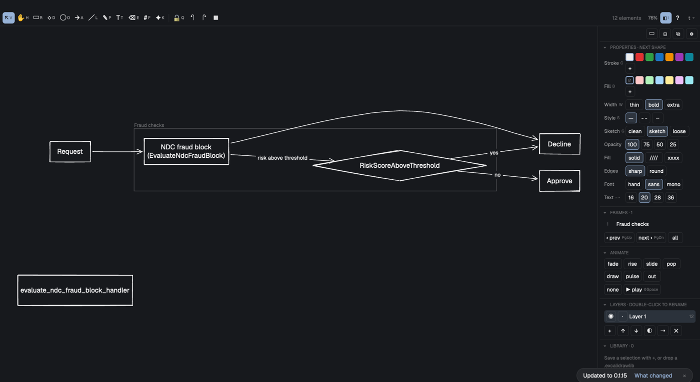
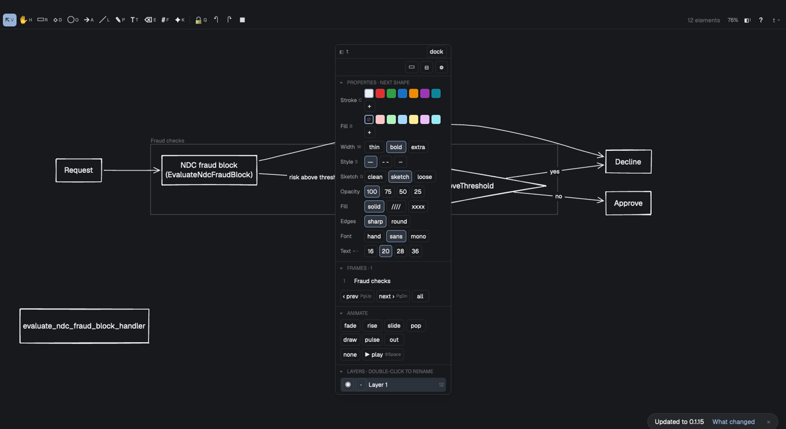
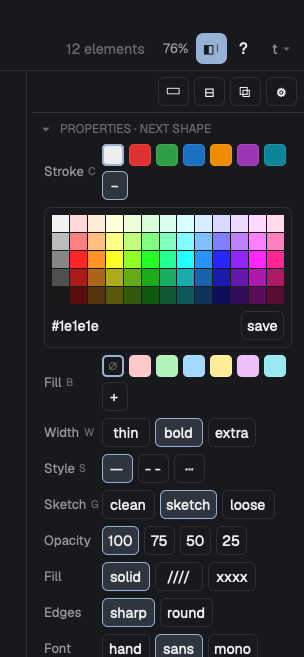

# herdr-draw

A sketchy whiteboard in a [Herdr](https://herdr.dev) pane, with layers, animation and a CLI
your coding agent draws with. Boards are plain `.excalidraw` files, so they still open in
[excalidraw.com](https://excalidraw.com).

> [!IMPORTANT]
> herdr-draw is a mod for the **Herdr desktop app** (the native macOS window). It doesn't run in
> `herdr`, the terminal app and CLI.



- **Draws like Excalidraw.** Rectangles, diamonds, ellipses, arrows that attach to shapes
  (straight, curved or elbowed), lines, pen, text, pictures, frames as pages, hand-drawn or
  clean strokes, hachure fills. The same keys as Excalidraw; `?` lists them all.
- **Agents draw too.** `drawh` adds shapes, labels, arrows, pictures and whole Mermaid
  flowcharts from the shell; the open pane picks every change up. `drawh check` tells the
  agent what overlaps, so diagrams come out readable.
- **Labels fit.** A box is never narrower than its label's longest word, long identifiers break
  at their seams (`EvaluateNdc` / `FraudBlock`), and Mermaid imports keep lines and labels apart.
- **Layers and animation.** Hide, lock and fade layers; animate elements on a timeline
  (fade, rise, slide, pop, draw, pulse) and play it back.
- **A side panel you arrange.** Properties, a color picker with your own palette, arrange,
  frames, layers and a shared library. Resize it, fold sections, show them as tabs, or pop it
  out into its own window (⧉).
- **Your boards anywhere.** `⌘O` lists your boards; a board on another machine Herdr reaches
  opens and saves there. Export PNG or SVG with `⌘⇧E`.

| Pop the panel out | A color picker |
|---|---|
|  |  |

## Install

Ask your agent in Herdr:

> add the mod github.com/ryanthedev/herdr-draw

then put the CLI on your PATH:

```sh
ln -s ~/.config/herdr-app/mods/herdr-draw/drawh ~/.local/bin/drawh
```

Or by hand:

```sh
git clone https://github.com/ryanthedev/herdr-draw
cp -R herdr-draw/mods/herdr-draw ~/.config/herdr-app/mods/
ln -s ~/.config/herdr-app/mods/herdr-draw/drawh ~/.local/bin/drawh   # the CLI for agents
```

Open a board with `drawh open ~/boards/plan.excalidraw`, or bind a key in
`~/.config/herdr-app/keys.json` to split a pane with `{"mod": "herdr-draw"}`: with no file it
opens the board picker.

**Needs:** the Herdr desktop app. `drawh` needs Python 3 and Node.js (or Bun): every write runs
the board's own layout code so the file opens right everywhere. Built and tested on macOS;
pictures, PNG export and rotated text use `sips`, copying uses `pbcopy`.

## For agents

```sh
drawh add plan.excalidraw rect --at 0,0 --label "API gateway" --id api
drawh add plan.excalidraw rect --at 300,0 --label "Orders service" --id orders
drawh arrow plan.excalidraw api orders --label "gRPC"
printf 'flowchart LR\n A[Client] -->|HTTPS| B[API] --> C[(Postgres)]' | drawh mermaid plan.excalidraw
drawh check plan.excalidraw     # overlaps, if any (exit 1)
drawh sel                       # what the person has selected in the pane
```

`drawh --help` lists everything: frames, layers, animation, pictures, the library, export.

## Develop

`bun test` runs the core headless and the real Herdr adapter on a fake GPUI.
`scripts/dev-sync.sh` installs a build into your Herdr; `scripts/release.sh` refreshes
`mods/herdr-draw` (what people install). See `CLAUDE.md` for the architecture.

## License

MIT
