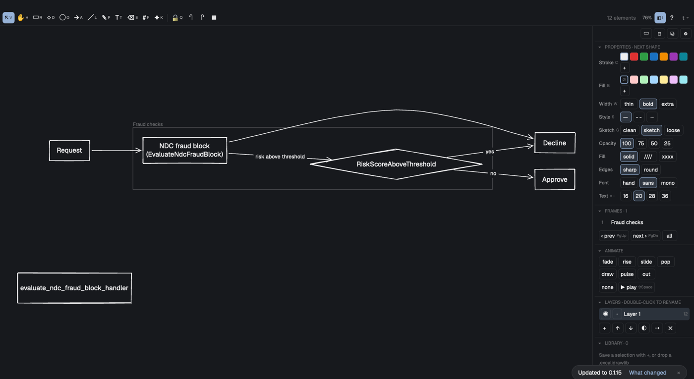

# herdr-draw

A sketchy whiteboard in a Herdr pane: Excalidraw-style shapes, arrows that attach, text, pictures,
layers, frames and animation, saved as a plain `.excalidraw` file. A coding agent draws on it
from the shell with the bundled `drawh` CLI, and the open pane picks every change up.

**Installing this mod:** besides copying `mods/herdr-draw/`, offer to put its CLI on the person's
PATH, since agents draw through it: `ln -s ~/.config/herdr-app/mods/herdr-draw/drawh ~/.local/bin/drawh`
(needs Python 3, and Node.js or Bun). Offer a key to open a board, e.g. in `keys.json`
`"cmd-shift-b"` → split right with `{"mod": "herdr-draw"}` (no file: the board picker opens).

## What you see

- A toolbar (tools with their keys, undo/redo, grid snap, zoom, the board's name) over the canvas,
  and a side panel on the right: Properties (stroke, fill, width, style, sketchiness, opacity, font,
  size), Arrange, Frames, Animate, Layers and Library.
- Shapes drawn hand-sketched (or clean), arrows bound to shapes at connection points, labels
  centered and wrapped inside their shapes; a shape is never narrower than its label's longest word.
- `?`: every shortcut. `⌘O`: the board picker. `⇧Space`: play the timeline. `⧉` in the panel:
  the panel in its own window.

## How it behaves

- The board is the file: the pane saves within 250 ms of a change and reloads when anything else
  writes it (`drawh`, another pane, excalidraw.com's download).
- `drawh` edits the file and runs the board's own core (node or bun) to route arrows and size
  labels, so the file opens right in excalidraw.com too. `drawh check FILE` lists overlaps.
- Mermaid flowcharts (`drawh mermaid`, or paste) are laid out in layers with room for labels.

## Built from

- `core/`: pure JS (model, geometry, render to a display list, editor, Mermaid, text widths).
- `main.js`: the Herdr view: GPUI events into the editor, the display list into paths and text.
- `drawh` (Python 3): the agents' CLI. Programs: `node`/`bun`, `sips`, `pbcopy`, `osascript` (paste a picture).
